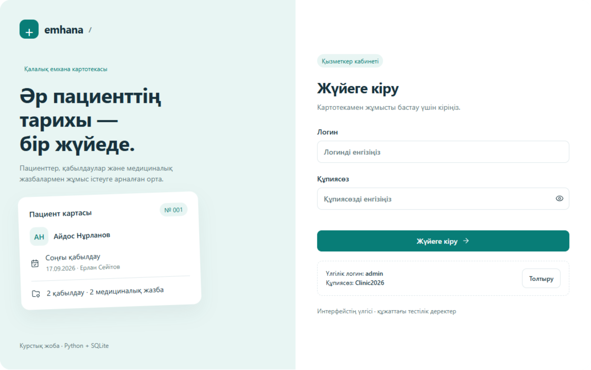
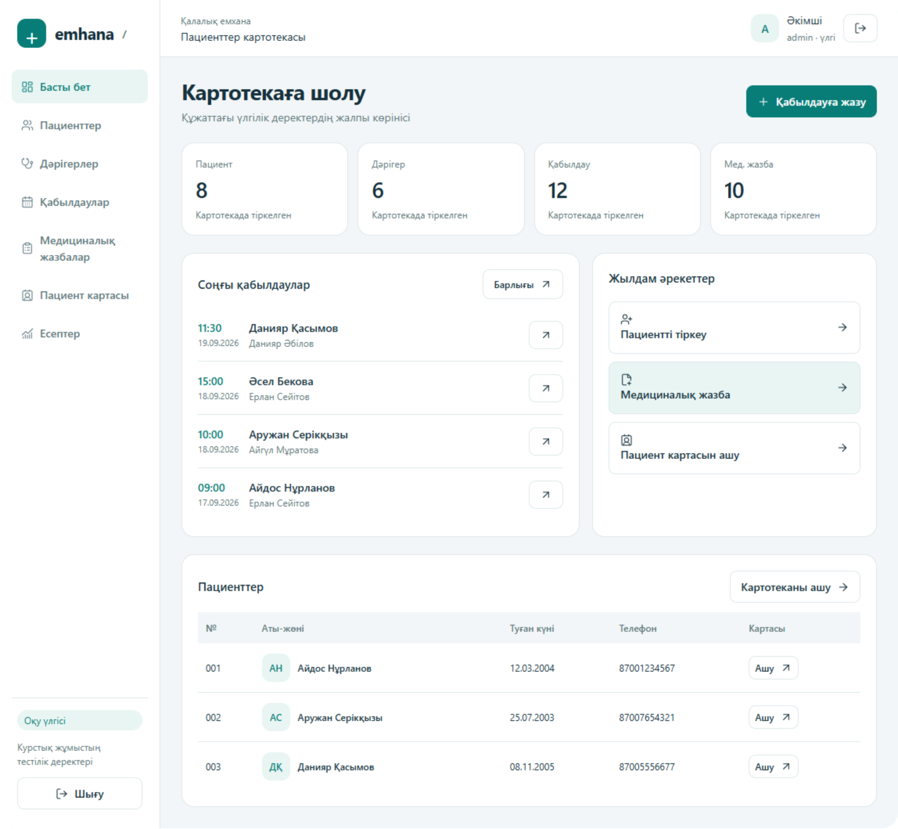

# Emhana — қалалық емхана пациенттерінің картотекасы

**Курстық жұмыс:** қалалық емхана пациенттерінің картотекасына арналған деректер базасын жобалау және Python мен SQLite арқылы іске асыру.

**Орындағандар:** Мырзабай Дінмұхамед және Елюбаев Алихан.

Жоба пациенттердің жеке мәліметтерін, дәрігерлерді, қабылдауларды және медициналық жазбаларды ұйымдастыруды көрсетеді. Репозиторийде курстық құжат, Python/SQLite бағдарламасы, браузерлік интерфейс және Android қосымшасы берілген.

## Курстық құжат пен қосымша

- [Курстық жұмысты жүктеу — DOCX](docs/%D0%9A%D0%A3%D0%A0%D0%A1%D0%A2%D0%AB%D0%9A%20%D0%94%D0%98%D0%9C%D0%90%D0%A8%20%D0%90%D0%9B%D0%98%D0%A5%D0%90%D0%9D%201.docx)
- [Android қосымшасын жүктеу — APK](downloads/Emhana-Android.apk)
- [Android коды мен орнату нұсқауы](android/README.md)

## Жобаның құрылымы

```text
docs/
  КУРСТЫК ДИМАШ АЛИХАН 1.docx   Курстық жұмыс
  images/               README үшін экран суреттері
python/
  database.py           SQLite базасы мен кестелерді құру
  data.py               Деректерді енгізу және өзгерту
  queries.py            SQL сұраныстары
  main.py               Консольдік бағдарламаның негізгі файлы
web/
  index.html            Интерфейстің басты файлы
  styles.css            Дизайн және мобильді бейімдеу
  app.js                Интерфейс логикасы
android/
  src/                  Java Activity
  assets/               Интернетсіз ашылатын интерфейс
  res/                  Android тақырыбы мен белгішесі
downloads/
  Emhana-Android.apk     Орнатылатын Android пакеті
```

## Python және SQLite бағдарламасын іске қосу

Python 3 қажет. Қосымша Python пакеттері талап етілмейді.

```bash
cd python
python main.py
```

Бағдарлама `clinic.db` үлгілік базасын жасайды және INSERT, UPDATE, DELETE, SELECT, WHERE, ORDER BY, GROUP BY, HAVING, JOIN операцияларын көрсетеді. `main.py` әр іске қосылғанда сол қапшықтағы `clinic.db` үлгілік базасын қайта құрады.

Негізгі кестелер: `patients`, `doctors`, `appointments`, `medical_records`. Демонстрация соңындағы деректер: 8 пациент, 6 дәрігер, 12 қабылдау, 10 медициналық жазба.

## Браузерлік интерфейсті ашу

`web/index.html` файлын Chrome немесе Edge браузерінде ашыңыз. `styles.css`, `app.js` және `lucide.min.js` сол қапшықта болуы керек. Интерфейс интернетсіз ашылады.

Үлгілік кіру деректері:

```text
Логин: admin
Құпиясөз: Clinic2026
```

Бөлімдер: басты бет, пациенттер, дәрігерлер, қабылдаулар, медициналық жазбалар, пациенттің толық картасы және есептер. Іздеу, сүзу, сұрыптау және жазбаларды басқару қарастырылған. Веб-нұсқадағы өзгерістер браузердің localStorage қоймасында сақталады.

## Android қосымшасы

`downloads/Emhana-Android.apk` файлын Android телефонына көшіріп, файл менеджері арқылы ашыңыз. Android 8.0 немесе одан жаңасы қажет. Қосымша интернетсіз жұмыс істейді және енгізілген жазбаларды сол телефонда сақтайды. Кіру деректері веб-нұсқамен бірдей.

APK қолтаңбасы тексерілген. Нақты телефонда орнату сынағы әзірге орындалмаған.

## Жобаның қазіргі күйі

Python/SQLite бағдарламасы мен веб/Android интерфейсі дербес үлгілер ретінде жұмыс істейді. Интерфейс Python/SQLite базасына әлі қосылмаған; үлгілік кіру серверлік аутентификацияны алмастырмайды. Барлық пациенттер мен медициналық жазбалар — оқу мақсатында құрастырылған тестілік деректер.

## Интерфейс көріністері





## Үшінші тарап кітапханасы

Белгішелерге [Lucide](https://lucide.dev/) қолданылған. Оның ISC лицензиясы [web/LUCIDE-LICENSE.txt](web/LUCIDE-LICENSE.txt) файлында сақталған.
