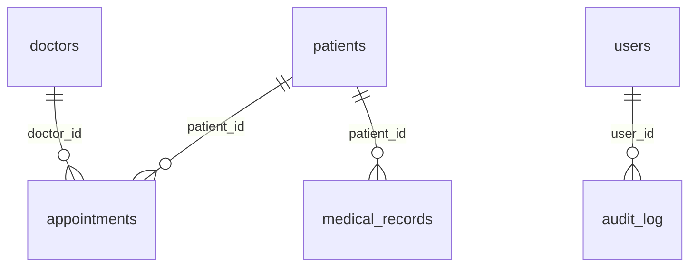

# Курстыққа сәйкестік және архитектура

Негізгі дереккөз — пайдаланушының соңғы **КУРСТЫК ДИМАШ АЛИХАН 1.docx** құжаты. Тақырыбы: қалалық емхана пациенттерінің картотекасына арналған деректер базасын жобалау және Python мен SQLite арқылы іске асыру. Мақсаты — байланысты медициналық картотеканы құрып, SQL арқылы деректерді өңдеуді көрсету.

## Бөлімдерге сәйкестік

| Курстықтағы бөлім | Жобадағы іске асыру |
|---|---|
| 1.1 Деректер базасы, өріс, жазба, кілт | Төрт негізгі кесте, бүтін нөмірлер, SQLite шектеулері |
| 1.2 Реляциялық модель | Пациент–қабылдау, дәрігер–қабылдау, пациент–медициналық жазба байланыстары |
| 1.3 SQL | CREATE TABLE, INSERT, UPDATE, DELETE, SELECT, транзакциялар |
| 2.1 Пәндік аймақ | Пациент тіркеу, дәрігер жүргізу, қабылдауға жазу, медициналық тарих |
| 2.2 Кестелер | `database.py`: құжаттағы төрт кестенің барлық негізгі өрісі |
| 2.3 Байланыстар | FOREIGN KEY, ON UPDATE CASCADE, ON DELETE RESTRICT; әр қосылымда foreign_keys=ON |
| 2.4 Диаграмма | Осы құжаттағы Mermaid және Баптаулардағы нақты SQL схема |
| 3.1 PyCharm | README-дегі VS Code/PyCharm іске қосу қадамдары |
| 3.2 Құру | `initialize_database`, алғашқы іске қосқанда автоматты схема |
| 3.3 Қосу, өзгерту, жою | Барлық төрт кестеге толық CRUD; `services.py` және Streamlit формалары |
| 3.4 Таңдау мен есептеу | SELECT *, таңдалған баған, жас, DISTINCT, COUNT/MIN/MAX |
| 3.5 Іздеу, сүзу, сұрыптау, топтау | WHERE, LIKE, BETWEEN, AND, ASC/DESC, LIMIT, GROUP BY, HAVING |
| 3.6 Бірнеше кесте | Үш кестелік JOIN, LEFT JOIN жүктеме, қайталама келушілер, диагноз және толық карта |
| Интерфейс | Жаңа талап бойынша Streamlit; әр әрекет SQLite-қа нақты жазылады |

## SQL функцияларының сәйкестігі

`queries.py` ішіндегі `QUERIES` кілттері құжаттағы бастапқы функциялармен бірдей: `select_all_patients`, `select_columns`, `select_with_age`, `select_distinct_diagnoses`, `select_patient_statistics`, `find_doctors_by_specialization`, `search_patients_by_name`, `appointments_between`, `women_born_before`, `patients_sorted_by_birth`, `latest_appointments_first`, `patients_by_gender`, `records_by_diagnosis`, `appointment_list`, `doctor_workload`, `frequent_patients`, `records_with_patients`.

`patient_card` қызметі пациенттің жеке мәліметтерін, қабылдауларын және медициналық жазбаларын үш бөлек таңдау арқылы жинақтайды. Барлығы — 17 таңдау функциясы және толық карта функциясы. `show()` функциясының экранға шығару міндетін Streamlit кестелері атқарады.

Бастапқы `main.py` демонстрациясының кезеңдері `demo.py` ішінде оқшауланған уақытша базада орындалады. Негізгі жұмыс базасы іске қосылған сайын қайта құрылмайды. Тұтастық шектеулерін тексеру автоматты тесттер мен әкімшінің `PRAGMA integrity_check` көрінісінде бар.

## Архитектура

```text
Streamlit интерфейсі app.py
        ↓
services.py — рөл, CRUD, аутентификация, аудит
        ↓
validation.py + security.py + queries.py
        ↓
database.py — параметрленген SQL және транзакция
        ↓
data/clinic.db — SQLite файлы
```

Әр дерекқор операциясына жеке қосылым ашылып, операция соңында жабылады. Мәліметтер Session State-та сақталмайды; онда тек кіру күйі, таңдалған бөлім және форма күйі болады. Мәліметтердің негізгі көзі әрдайым SQLite. WAL және busy_timeout қысқа қатарлас операцияларды реттейді.



## Кестелер

- `patients`: id, full_name, birth_date, gender, phone, address.
- `doctors`: id, full_name, specialization, phone, cabinet.
- `appointments`: id, patient_id, doctor_id, appointment_date, appointment_time, reason.
- `medical_records`: id, patient_id, record_date, diagnosis, complaint, recommendation.
- `users`: нөмір, логин, қызметкер аты, пароль хэші, рөл, белсенділік, қате кіру саны, бұғатталу және құрылу уақыты.
- `audit_log`: әрекет жасаған қолданушы, операция, кесте, жазба нөмірі және UTC уақыты. Құпиясөз журналға жазылмайды.
- `app_meta`: бастапқы толтыру орындалғанын белгілейді.

## Тақырыпқа сәйкес қосылған функциялар

Кіру жүйесі, үш рөл, құпиясөзді өзгерту, тұрақты аудит, база көшірмесі, екі рет қабылдауға жазылуды тоқтату және қазақша регистрді елемейтін іздеу енгізілді. Бұлар бастапқы картотеканы күнделікті қолдануға ыңғайлайды. Жас туған күннің айы/күні ескеріліп есептеледі; бұл бастапқы 365.25 күнге жуықтау формуласынан дәлірек.

Курстықтағы бұрынғы HTML/CSS/JavaScript үлгісіне қатысты мәтін жаңа Streamlit іске асыруының сипаттамасы емес. Пайдаланушының соңғы талабы бойынша осы жоба тек Python/SQLite/Streamlit-пен жасалды. Негізгі төрт кесте мен SQL міндеттері сақталды. Word файлы бұл тапсырмада қайта жазылмаған; ескі интерфейс сипаттамасын жаңа нұсқамен сәйкестендіру бөлек редакция болады.
